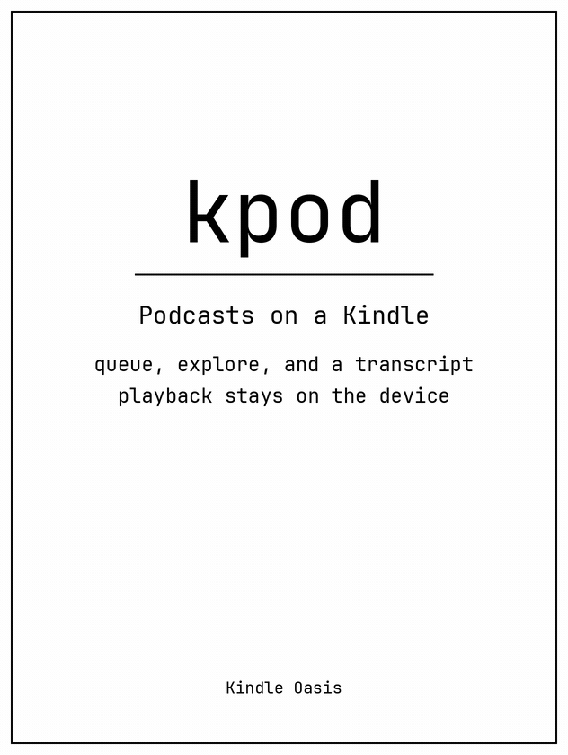

# kpod

## A podcast player for an e-ink Kindle.

kpod turns a jailbroken Kindle into a podcast player. It keeps an OPML
subscription list, downloads MP3 episodes, and plays them through a paired
Bluetooth speaker. The page shows the episode, the queue, and a transcript
that follows playback, with controls laid out for an e-ink screen. It targets
a Kindle Oasis 10th generation (`kindlehf`, firmware 5.16.x) with
[KPM](https://github.com/KindleModding/KPM) installed.



The demo is captured from a real Kindle Oasis. It shows the player with a
connected Bluetooth speaker, the queue, Explore, Compact, and the transcript.

## What you need

- A KPM-compatible jailbroken Kindle.
- A kpod `.kpkg` built for `kindlehf`.
- Wi-Fi, for feeds, episodes, and transcripts.
- A paired Bluetooth speaker or headphones. Pair it in Kindle Settings.
  The player can reconnect that speaker; it does not pair a new one.
- An OPML file, or a show added from the in-app directory.

kpod plays MP3 episodes. Other enclosures can appear in Explore and are
marked unavailable.

## Install

Install the `.kpkg` with KPM, then open **kpod** from the Kindle Home screen.

```text
;kpm install kpod
```

To start from an OPML export, copy it to:

```text
/mnt/us/kpod/var/subscriptions.opml
```

Open kpod and tap **Sync** in Explore. Sync reads the feeds, keeps a catalog
of episodes, and queues the latest MP3s up to the retention cap (20 by
default).

You can also tap **Add show**, search the public podcast directory, or paste
a feed URL.

## Listening

The player shows the episode title, the show name, a progress bar, and the
played time next to the episode length.

| Control | Action |
| --- | --- |
| Rewind / forward | Skip 15 seconds |
| Play | Play or pause the current episode |
| Bluetooth | Connect the paired speaker, or disconnect it |
| Up next | The play queue |
| Explore | Search the catalog, sync, and add shows |
| Compact | Hide the title and progress row |

The line under the player is the transcript. It follows playback. The
highlighted sentence is underlined. Feed transcripts (plain text, WebVTT,
SRT, or JSON) are used when the feed provides one.

A status message sits under the buttons and does not move them. It is hidden
when there is nothing to report.

## Transcript service

Leave `transcriptApi` empty in `/mnt/us/kpod/var/config.json` and kpod only
uses transcripts from the feed. To generate the rest, point it at a service
that speaks this contract:

```text
GET {transcriptApi}?url={audio}&id={episode}
```

- `200` with WebVTT, SRT, JSON, or plain text: the transcript is ready.
- `503`: still working. kpod keeps asking and shows it when it arrives.
- `502`: the job failed.

`tools/kpod-transcript/` is one implementation. A small Python service caches
WebVTT. A worker runs [whisper.cpp](https://github.com/ggerganov/whisper.cpp)
and joins the caption fragments into one cue per sentence. Apple Podcasts
episode pages are resolved to the embedded audio file before download.

```sh
# On the worker, after whisper-cli and a ggml model are installed:
/srv/kpod-transcript/transcribe.sh 'AUDIO_OR_APPLE_EPISODE_URL' WORK_ID
```

Caddy should proxy only `/health` and `/transcript` to `127.0.0.1:8777`.
See `tools/kpod-transcript/Caddyfile` and `kpod-transcript.service`. Set
`KTR_WORKER` to an SSH host that has the worker script, or leave it empty to
run whisper on the same machine.

## Storage and upgrades

Subscriptions, config, the catalog, and the queue live in `/mnt/us/kpod/var/`.
Episode files live in `/mnt/us/kpod/episodes/`. Both survive a kpod upgrade.
Back them up before a Kindle reset.

KPM reinstalls a package only when its version changes.

## Troubleshooting

- Empty queue after Sync: confirm the OPML path and that Wi-Fi is connected.
- `mp3 only`: that enclosure is not MP3.
- No sound: the speaker must be paired in Kindle Settings. Use the Bluetooth
  button to connect it, then play again. If the Kindle reports the speaker
  is not in range, disconnect it from other devices and power-cycle it.
- A stale screen: reopen kpod from Home. That restarts the background service.

## Build

```sh
just toolchain   # once: kindlehf gcc and a liblipc link stub
just test        # host tests; does not link the Kindle daemon
just package     # dist/kpod_<version>_kindlehf.kpkg
```

`just package x.y.z` sets the package version. The daemon links `liblipc`,
which exists only on the Kindle, so `cargo build` of `kpodd` on the host is
not a supported check. `cargo test -p kpod --lib` runs the portable logic.

`just publish` uploads the package to a KPM catalog. The default remote is
`https://github.com/qingshan/kindle.git`. Override it with
`KINDLE_CATALOG_REPO`. A private catalog needs `KINDLE_CATALOG_TOKEN`.

`just e2e` runs the host page suite. It does not need a Kindle. `just demo`
records a tour of the installed player and encodes `dist/demo/kpod-demo.mp4`.
The README tour is `docs/kpod-demo.gif`, copied from that render. The Kindle
SSH host is `kindle`; override it with `KINDLE_E2E_HOST`. The tour does not
sync, play, or edit the queue. See [docs/e2e.md](docs/e2e.md).

## License

Code is MIT. See [LICENSE](LICENSE).

The player icons use JetBrains Mono Nerd Font, which is covered by the
[SIL Open Font License](kpm/waf/fonts/OFL.txt), not the MIT license.

## Publishing

Build with `just package <version>` and upload the `.kpkg` to the matching
GitHub Release (`v<version>`). Then run `just publish <version>` to update
the shared KPM catalog with the release download URL. Package archives stay
in GitHub Releases; only their URLs are stored in the catalog. The release
workflow can update the catalog when `KINDLE_CATALOG_TOKEN` is configured.
